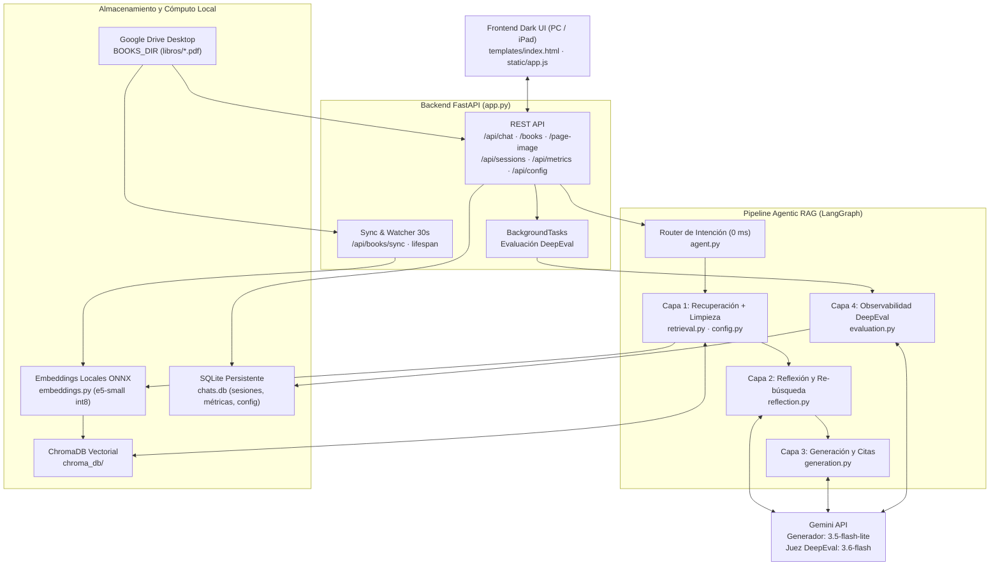
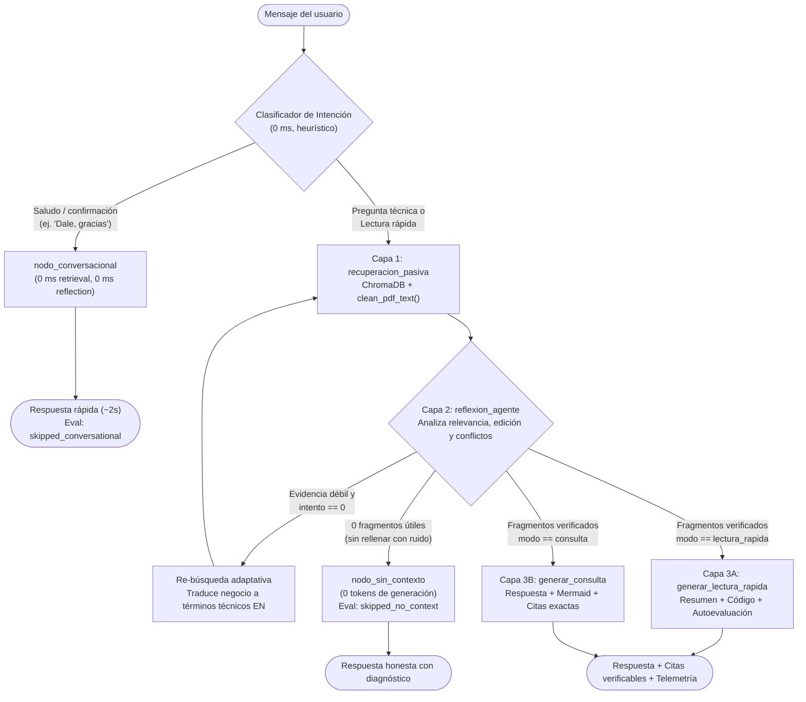
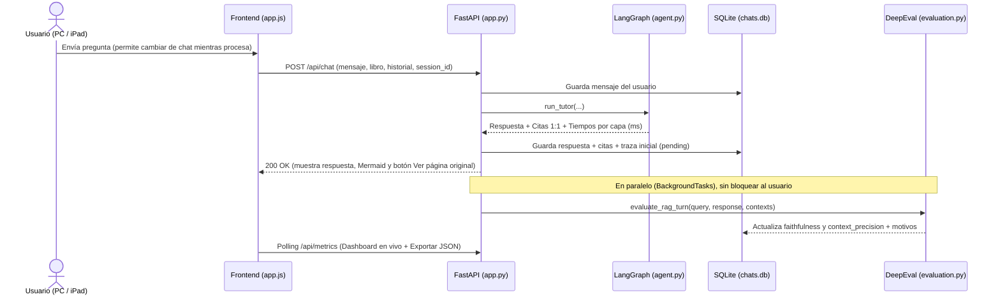
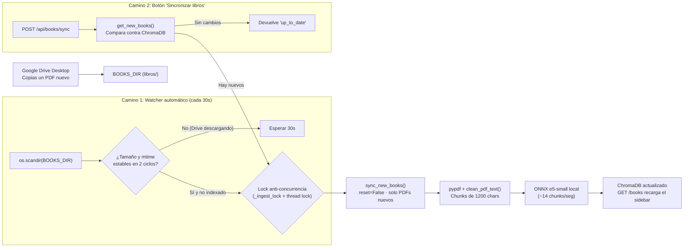

# Arquitectura y Funcionamiento de Tutor RAG

Esta guía explica cómo están conectadas todas las piezas de **Tutor RAG** y qué ocurre exactamente cada vez que hacés una pregunta, agregás un PDF nuevo en Google Drive o abrís el Dashboard de Observabilidad.

---

## 1. Mapa general del sistema

El proyecto combina procesamiento **100% local** para tus libros, embeddings y chats (sin costo de API ni límites diarios de embeddings) con **Gemini** solo para razonamiento, redacción y evaluación de calidad.

---

## 2. Cómo piensa el agente: Grafo LangGraph paso a paso

Cada mensaje que enviás al chat entra a `run_tutor()` en [agent.py](agent.py). En vez de hacer un RAG rígido de un solo paso, el grafo decide dinámicamente qué camino tomar:

> [!TIP]
> **Por qué esto es mejor que un RAG clásico:**
> 1. **Ahorra ~8–10s** en mensajes conversacionales porque ni siquiera toca ChromaDB.
> 2. **No alucina cuando un libro no tiene el tema:** si la reflexión descarta todo (`0` chunks), corta directo a `sin_contexto` sin gastar tokens de generación.
> 3. **Limpia ruido editorial** (`Weak Isolation Levels | 233`, índices con puntos, números de página sueltos) automáticamente en tiempo real sin tener que re-indexar `chroma_db/`.

---

## 3. Secuencia de una consulta + Evaluación en segundo plano

Para que el chat se sienta rápido, la respuesta te llega apenas termina la generación, mientras **DeepEval** audita fidelidad y relevancia en segundo plano con un modelo juez independiente:

---

## 4. Auto-indexación incremental desde Google Drive Desktop

Cuando copiás un PDF nuevo en tu carpeta sincronizada (`BOOKS_DIR`), tenés dos caminos automáticos y seguros contra concurrencia:

---

## 5. Mapa rápido de archivos del proyecto

| Archivo | Rol en el sistema |
|---|---|
| [config.py](config.py) | Rutas (`BOOKS_DIR`, `CHROMA_DIR`), carga de `.env`, títulos legibles de libros, lista de modelos Gemini y `clean_pdf_text()`. |
| [embeddings.py](embeddings.py) | Embeddings locales ONNX (`Xenova/multilingual-e5-small` int8, 384 dims) sin PyTorch y sin cuota de API. |
| [ingest.py](ingest.py) | Ingesta incremental/reanudable por IDs deterministas, `get_new_books()` y `sync_new_books()` con lock de concurrencia. |
| [retrieval.py](retrieval.py) | Capa 1: búsqueda bilingüe equilibrada, filtro por libro, comparación entre autores, resumen de libro entero, muestreo O(1) para Lectura rápida y contextualización de repreguntas. |
| [reflection.py](reflection.py) | Capa 2: crítico previo a la generación; descarta ruido, resuelve conflictos entre ediciones, permite devolver `0` chunks y traduce consultas de negocio en re-búsquedas técnicas. |
| [generation.py](generation.py) | Capa 3: prompts editoriales (Consulta, Lectura rápida, Conversacional), guía de Mermaid, citas 1:1 y fallback automático de modelos Gemini. |
| [evaluation.py](evaluation.py) | Capa 4: evaluación online con DeepEval (`FaithfulnessMetric` + `ContextualRelevancyMetric`) usando juez independiente y fallback JSON estructurado. |
| [agent.py](agent.py) | Orquestador LangGraph que une router de intención + las 3 capas y mide latencia por etapa (`retrieval_ms`, `reflection_ms`, `generation_ms`). |
| [db.py](db.py) | Persistencia permanente en SQLite (`chats.db`, modo WAL) para sesiones multi-dispositivo, mensajes, citas, métricas RAG y configuración en caliente. |
| [app.py](app.py) | Servidor FastAPI: endpoints de chat, sesiones, visor de páginas PDF (`/page-image` con PyMuPDF), observabilidad, configuración, `/api/books/sync` y watcher en `lifespan`. |
| [templates/index.html](templates/index.html) / [static/app.js](static/app.js) / [static/styles.css](static/styles.css) | Interfaz dark responsive (PC + iPad): chats concurrentes, hilo paralelo (*Deep Dive*), menú contextual/barra flotante, Mermaid.js, visor PDF, botón de sincronización y Dashboard de Observabilidad con exportación JSON. |
| [tests/](tests/) | 12 pruebas unitarias automatizadas (motor vectorial, router de intención, limpieza PDF, reflexión `0` chunks y sync incremental). |
