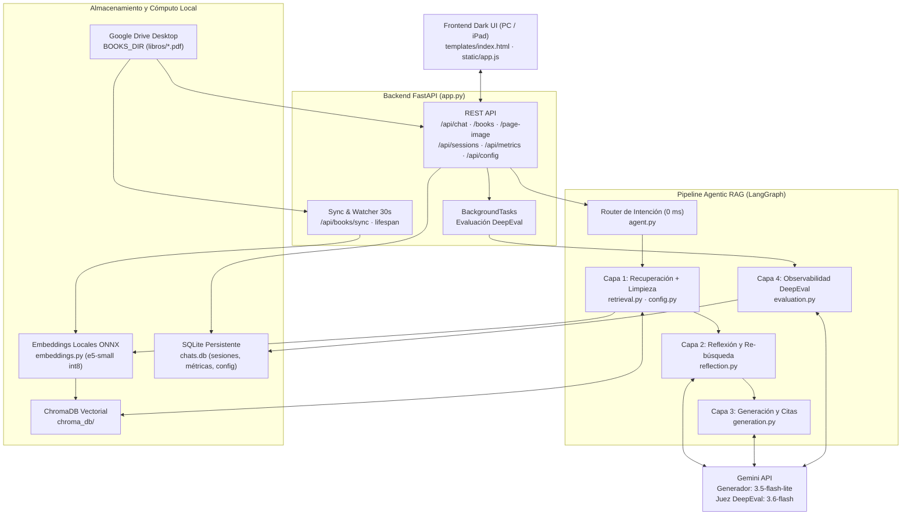

# Tutor RAG Multi-dispositivo

Tutor técnico personal basado en tus libros en PDF, construido con **LangGraph (Agentic RAG de 4 capas)**, **ChromaDB + ONNX local**, **DeepEval**, **SQLite** y **FastAPI**, con una interfaz web oscura **mobile-first** optimizada para estudiar desde PC, iPad o celular en tu misma red Wi-Fi.

---

## Arquitectura general



> **Guía visual completa:** consultá [ARCHITECTURE.md](ARCHITECTURE.md) para ver los 4 diagramas detallados (grafo LangGraph con router conversacional y re-búsqueda conceptual, secuencia de evaluación DeepEval en segundo plano y flujo de auto-indexación incremental desde Google Drive Desktop).

### Estructura del proyecto

```text
tutor-rag/
├── libros/               # Carpeta de PDFs o symlink a Google Drive Desktop (ignorada por git)
├── chroma_db/            # Base vectorial persistente (ignorada por git)
├── chats.db              # Sesiones multi-dispositivo, métricas RAG y config (ignorada por git)
├── templates/
│   └── index.html        # Interfaz web dark (Tailwind + Mermaid + Visor PDF + Observabilidad)
├── static/
│   ├── styles.css        # Estilos editoriales, código y dashboard Bento
│   └── app.js            # Chats concurrentes, hilo paralelo, visor PDF, sync y observabilidad
├── config.py             # Rutas (BOOKS_DIR/LIBROS_DIR), modelos Gemini y limpieza de ruido PDF
├── embeddings.py         # Embeddings locales livianos ONNX int8 (multilingual-e5-small)
├── ingest.py             # Ingesta incremental/reanudable y sync_new_books() con lock
├── retrieval.py          # Capa 1: búsqueda bilingüe, multi-libro, resumen y repreguntas
├── reflection.py         # Capa 2: crítico previo, resolución de conflictos y re-búsqueda conceptual
├── generation.py         # Capa 3: prompts editoriales, Mermaid, citas 1:1 y fallback de modelos
├── evaluation.py         # Capa 4: evaluación online DeepEval (Faithfulness + ContextualRelevancy)
├── agent.py              # Orquestador LangGraph (router de intención + 3 capas + telemetría)
├── db.py                 # Capa SQLite en modo WAL (sesiones, mensajes, rag_metrics, settings)
├── app.py                # Backend FastAPI + watcher automático de BOOKS_DIR cada 30s
├── tests/                # Suite de pruebas unitarias (unittest)
├── ARCHITECTURE.md       # Guía visual detallada con diagramas Mermaid
├── .env                  # Variables de entorno locales (ignorado por git)
├── pyproject.toml        # Dependencias gestionadas con uv
└── README.md
```

---

## 1. Configuración inicial

1. Abrí el archivo `.env` en la raíz del proyecto y completá tu clave de Google AI Studio (`GEMINI_API_KEY`):

```env
GEMINI_API_KEY="tu_api_key_de_gemini"
LANGSMITH_API_KEY=""
LANGSMITH_TRACING="true"
LANGSMITH_PROJECT="tutor-rag"
```

> **Nota sobre LangSmith:** Si todavía no cargás `LANGSMITH_API_KEY`, el proyecto desactiva automáticamente el envío de trazas en memoria para evitar advertencias 401. En cuanto pegues tu clave, el tracing se activa solo.

2. Si necesitás sincronizar dependencias en otro equipo con `uv`:

```powershell
uv sync
```

---

## 2. Indexar tus libros (`ingest.py`)

Copiá uno o más archivos `.pdf` dentro de la carpeta `libros/` y ejecutá:

```powershell
uv run python ingest.py
```

Qué hace `ingest.py`:
- Escanea `libros/*.pdf` conservando `source` (nombre del PDF) y `page` (número de página 1-based).
- Divide el texto con `RecursiveCharacterTextSplitter(chunk_size=1200, chunk_overlap=200)`.
- Calcula embeddings localmente en CPU con `Xenova/multilingual-e5-small` vía **ONNX Runtime int8** (multilingüe español + inglés, ~129 MB, sin límites de API) y los guarda en `chroma_db/`. Si preferís embeddings en la nube de Gemini, cambiá `EMBEDDING_PROVIDER="gemini"` en `.env` y corré `ingest.py --reset`.
- **Es incremental y reanudable:** asigna IDs deterministas por fragmento (`source + hash + índice`), omite los PDFs completos sin cambios y, si se interrumpe (por `Ctrl+C` o cuota de Gemini Free Tier), retoma exactamente desde el último lote guardado.
- **Control de cuota Free Tier:** regula automáticamente los lotes para respetar los límites de Gemini Free Tier (`100 req/min` y `30.000 tokens/min`). Si usás cuenta paga, podés agregar `--no-rate-limit`.

### Indexar solo uno o dos libros específicos (`--only`)

Si tenés muchos libros pesados y querés empezar a estudiar rápido con 1 o 2 títulos primero:

```powershell
uv run python ingest.py --only "Pragmatic" --only "Clean Code"
```

### Re-indexar desde cero (`--reset`)

Si querés borrar toda la colección vectorial y volver a procesar todos los PDFs:

```powershell
uv run python ingest.py --reset
```

También podés disparar la re-indexación incremental en cualquier momento desde el botón **Re-indexar** de la interfaz web (que llama a `POST /api/ingest`).

---

## 3. Levantar el servidor para iPad / Celular (`0.0.0.0:8000`)

Para que el servidor escuche en todas las interfaces de red de tu PC y sea accesible desde otros dispositivos en el mismo Wi-Fi:

```powershell
uv run uvicorn app:app --host 0.0.0.0 --port 8000
```

*(Alternativa equivalente: `uv run python app.py`)*

### Cómo entrar desde el iPad o celular

1. Asegurate de que tu PC y tu iPad/celular estén conectados a la **misma red Wi-Fi**.
2. En tu PC con Windows, abrí PowerShell y consultá tu dirección IP local:

```powershell
ipconfig
```

Buscá la línea **Dirección IPv4** de tu adaptador Wi-Fi (por ejemplo: `192.168.1.42`).

3. En Safari (iPad/iPhone) o Chrome (Android), abrí:

```text
http://192.168.1.42:8000
```

> **Tip para iPad/iPhone:** En Safari tocá **Compartir → Agregar a inicio** para usar Tutor RAG en pantalla completa como una app nativa.

---

## 4. Permitir el puerto 8000 en el Firewall de Windows

Si desde el iPad/celular la página no carga, el Firewall de Windows está bloqueando conexiones entrantes al puerto `8000`. Permitilo **únicamente para redes Privadas (tu Wi-Fi de casa)**:

### Opción A — PowerShell (ejecutado como Administrador)

```powershell
New-NetFirewallRule `
  -DisplayName "Tutor RAG (Puerto 8000)" `
  -Direction Inbound `
  -Protocol TCP `
  -LocalPort 8000 `
  -Profile Private `
  -Action Allow
```

Para eliminar la regla en el futuro si ya no la necesitás:

```powershell
Remove-NetFirewallRule -DisplayName "Tutor RAG (Puerto 8000)"
```

### Opción B — Interfaz gráfica de Windows

1. Abrí **Seguridad de Windows → Firewall y protección de red → Configuración avanzada**.
2. Hacé clic en **Reglas de entrada → Nueva regla...**
3. Elegí **Puerto** → **TCP** → **Puertos locales específicos:** `8000`.
4. Elegí **Permitir la conexión**.
5. Marcá **solo Privado** (desmarcá *Público* por seguridad).
6. Poné el nombre `Tutor RAG (Puerto 8000)` y hacé clic en **Finalizar**.

> Verificá además que tu red Wi-Fi de casa esté configurada con perfil **Red privada** en *Configuración de Windows → Red e Internet → Wi-Fi → Propiedades de la red*.

---

## 5. Endpoints de la API

| Método | Ruta | Descripción |
| --- | --- | --- |
| `GET` | `/` | Espacio de estudio web (`templates/index.html` + `/static/styles.css` y `/static/app.js`) |
| `GET` | `/books` | Lista dinámica de PDFs indexados en ChromaDB y estadísticas |
| `GET` | `/page-image` | Renderiza en PNG (PyMuPDF 2x) la página original exacta de un libro citado |
| `POST` | `/api/chat` | Ejecuta el grafo Agentic RAG, persiste el turno en SQLite y agenda DeepEval en segundo plano |
| `POST` | `/api/books/sync` | Detecta e indexa en segundo plano únicamente los PDFs nuevos en `BOOKS_DIR` |
| `GET` | `/api/books/sync/status` | Consulta el estado de la sincronización incremental en curso |
| `POST` | `/api/ingest` | Ejecuta la ingesta incremental completa (acepta `{ "reset": true }` opcionalmente) |
| `GET/POST/PATCH/DELETE` | `/api/sessions` | Gestión persistente de chats multi-dispositivo en SQLite |
| `GET/DELETE` | `/api/metrics` | Métricas de observabilidad DeepEval, latencias por etapa y trazas recientes |
| `GET/PATCH` | `/api/config` | Configuración en caliente del pipeline (reflexión, re-búsqueda, evaluación, modelo LLM) |
| `GET` | `/api/health` | Verificación rápida del estado del backend |
